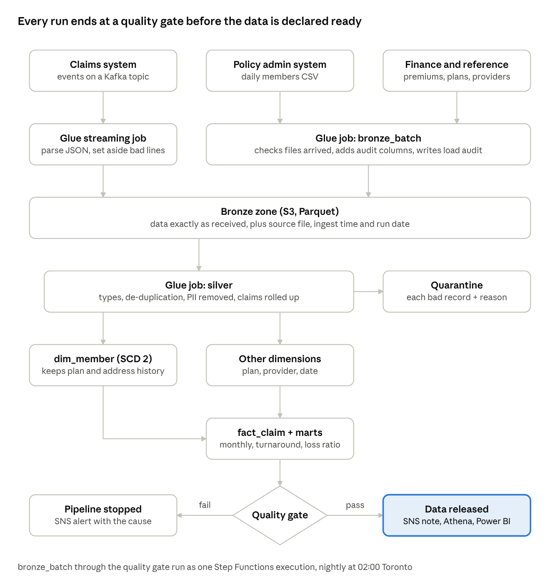
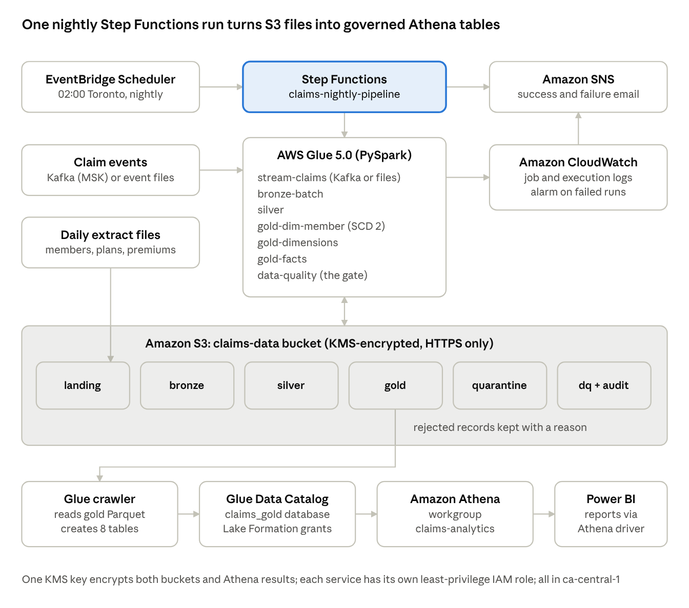
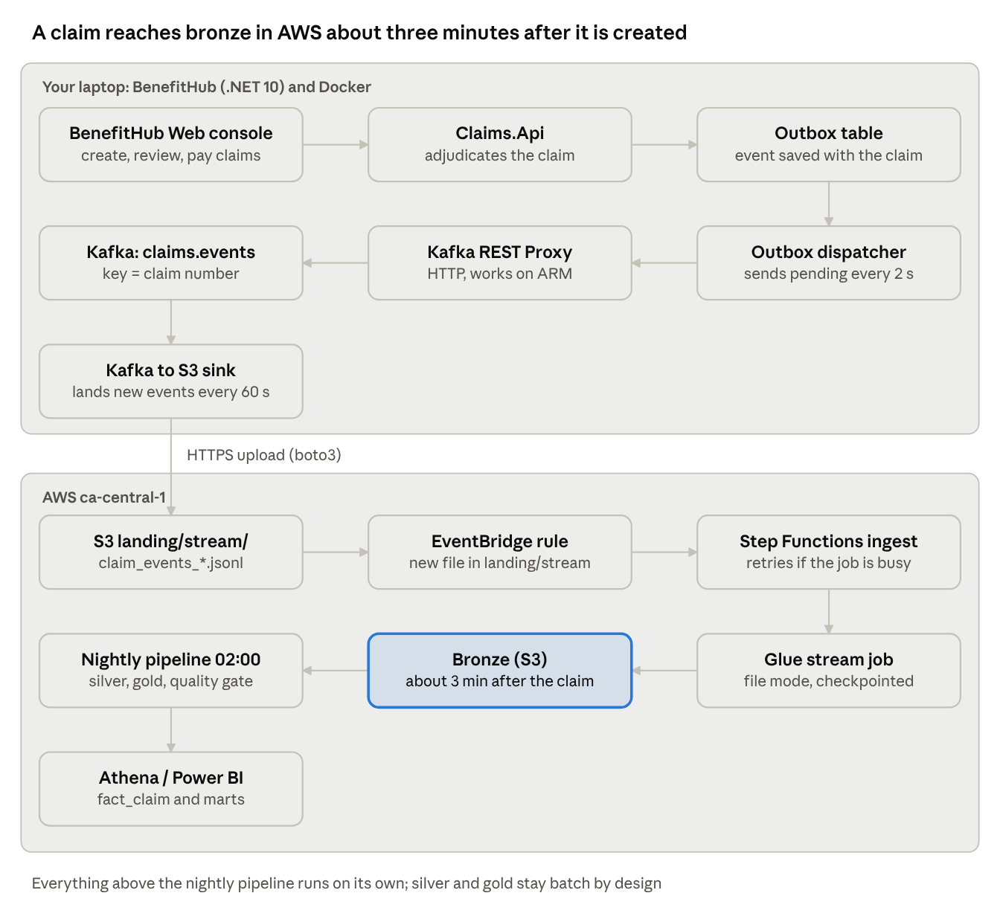

# Group Benefits Claims Data Platform

A data platform for a group benefits insurer's Canadian operations. It turns claim events from Kafka and daily extracts from the policy admin and finance systems into a governed star schema and operational reports. It runs on AWS Glue with Step Functions orchestration.

It answers questions an operations and finance team asks every day:

- What did we pay this month, by benefit type and province?
- Which employer groups have a high loss ratio (claims paid ÷ premium)?
- How fast do we close claims, by channel (mobile app, provider EDI, paper)?
- Why are claims denied, and how much liability is still open?

All data is synthetic: 3,000 members in 4 employer groups, 28 providers, and about 1,500 claims over two business days.

## Architecture

**Data flow:** every run ends at a quality gate before the data is released.



**AWS architecture:** one nightly Step Functions run turns S3 files into governed Athena tables.



**Real-time ingest:** a claim created in a .NET claims app reaches bronze in AWS about three minutes later.



The nightly batch is a **Step Functions** state machine (`orchestration/claims_pipeline.asl.json`) started by **EventBridge Scheduler** at 02:00 Toronto time. Any failed step is caught and sends an SNS alert.

## What the project covers

| Capability | Where it is in this project |
|---|---|
| Scalable pipelines with **AWS Glue, Kafka and Step Functions** | Glue jobs in `glue_jobs/`; Kafka producer and streaming job; state machine in `orchestration/` |
| ETL with **SSIS / Informatica / Talend** | `docs/ssis_to_glue_mapping.md`: how an SSIS member-load package maps to these Glue jobs, and a migration approach |
| **Data models** for BI and analytics | Star schema: `fact_claim`, `dim_member` (SCD Type 2), `dim_plan`, `dim_provider`, `dim_date`, plus three marts |
| **Data quality, security and compliance** | Quarantine with reasons, 11 data-quality rules with a critical/warn gate, reconciliation, PII removed from silver, KMS encryption, TLS-only buckets, least-privilege IAM |
| **Troubleshoot** data issues | Load audit, quarantine table, DQ results history, SNS alerts with the error cause, rerunnable jobs |
| **Data warehousing** concepts | Medallion layers, conformed dimensions, SCD2 with point-in-time joins, partitioned facts |
| **Various databases and formats** | CSV, JSON lines, Kafka messages, Parquet, Glue Data Catalog, Athena, DuckDB |
| **Kafka and stream processing** | Keyed producer (ordering per claim), Spark Structured Streaming, checkpoints, at-least-once + de-duplication |
| Hadoop / **Spark** / Hive | PySpark throughout; Glue Data Catalog is a Hive-compatible metastore |
| **Power BI** | Gold tables are a star schema ready for Power BI through the Athena connector |
| Mentoring and best practices | Shared `common` package, one job pattern, unit tests, a runbook |

## Run it locally (WSL / Linux)

Needs Python 3.11 (the Glue 5.0 version) and Java 17. On Windows, use WSL Ubuntu.

```bash
sudo apt-get update && sudo apt-get install -y openjdk-17-jre-headless
curl -LsSf https://astral.sh/uv/install.sh | sh && source $HOME/.local/bin/env
cd ~/benefits-claims-platform
uv venv --python 3.11 .venv && source .venv/bin/activate
uv pip install -r requirements.txt

python -m pytest -q          # 15 tests
bash run_demo.sh             # day 1, day 2, then the business questions
```

Step by step instead of `run_demo.sh`:

```bash
python data_gen/generate_sources.py --day 1                       # creates local/landing and local/stream
python orchestration/run_local.py --run-date 2026-10-20 --with-stream
python data_gen/generate_sources.py --day 2                       # member changes, new claims, late payments
python orchestration/run_local.py --run-date 2026-10-21 --with-stream
python sql/query_local.py                                         # business questions, quarantine, DQ, audit
python orchestration/run_local.py --run-date 2026-10-22           # no files for that day: shows the failure alert
```

`run_local.py` executes the **real** state machine JSON locally: the same states, Retry and Catch rules that AWS runs, with each Glue task calling the job's `run()` in a local Spark session.

### Optional: with a real Kafka broker (Docker)

```bash
docker compose up -d
python data_gen/generate_sources.py --day 1
python streaming/produce_claim_events.py --file local/stream/incoming/claim_events_20261020.jsonl
python orchestration/run_local.py --run-date 2026-10-20 --with-stream --stream-source kafka
docker compose down
```

## Deploy to AWS

```bash
cd infra/terraform
cp terraform.tfvars.example terraform.tfvars      # set alert_email
terraform init && terraform apply
BUCKET=$(terraform output -raw data_bucket)
aws s3 cp ../../local/landing s3://$BUCKET/landing --recursive
aws s3 cp ../../local/stream/incoming s3://$BUCKET/landing/stream/ --recursive
aws glue start-job-run --job-name claims-stream-claims          # claim events -> bronze (files mode)
aws stepfunctions start-execution --state-machine-arn $(terraform output -raw state_machine_arn) \
    --input '{"run_date":"2026-10-20"}'
aws glue start-crawler --name claims-gold-crawler                # then query in Athena
```

The batch path costs cents per run (6 short Glue jobs at 2 workers). The streaming path (MSK + Glue streaming job) is off by default because it bills by the hour; turn it on with `-var enable_streaming=true` only for a demo, then turn it off.

## What was tested where

- **Run locally:** the generator, all batch jobs, the streaming job reading files, the state machine (local interpreter, including the failure path), 15 unit tests, and the business queries.
- **Deployed and run in AWS (ca-central-1, Oct 2026):** Terraform built S3, KMS, IAM, the Glue jobs, catalog and crawler, Step Functions, EventBridge Scheduler, SNS, the CloudWatch alarm and Athena. The state machine loaded day 1 (700 claims) through bronze, silver and gold, and Athena answered the business questions.
- **Real-time path verified end to end:** claims created in a .NET claims app went through Kafka (Docker), the Kafka-to-S3 sink, EventBridge, Step Functions and the Glue stream job, reaching bronze about three minutes after creation.
- **Optional, left off to save cost:** the Amazon MSK streaming path (`enable_streaming = true`), which bills by the hour.

## Project layout

```
data_gen/generate_sources.py        synthetic members, plans, providers, premiums, claim events (with planted problems)
streaming/produce_claim_events.py   publishes events to Kafka, keyed by claim_id
glue_jobs/
  common/                           runtime (Glue or local), PII rules, schemas, data-quality framework
  job_stream_claims_to_bronze.py    Kafka/files -> bronze (+ malformed quarantine)
  job_bronze_batch.py               daily extracts -> bronze, file-arrival check, load audit
  job_silver.py                     typing, de-duplication, PII removal, quarantine, claim roll-up
  job_gold_dim_member.py            SCD Type 2 member dimension
  job_gold_dimensions.py            plan, provider, date dimensions
  job_gold_facts.py                 fact_claim and the three marts
  job_data_quality.py               11 rules, results table, fails the run on critical rules
orchestration/
  claims_pipeline.asl.json          Step Functions definition (deployed by Terraform)
  run_local.py                      runs that definition locally
glue_dq/claims_ruleset.dqdl         the same checks in AWS Glue Data Quality's language
sql/athena/business_questions.sql   Athena queries; sql/query_local.py runs them with DuckDB
infra/terraform/                    S3, KMS, IAM, Glue jobs, catalog, crawler, Step Functions, scheduler, SNS, alarm, Athena, optional MSK
docs/ssis_to_glue_mapping.md        SSIS package -> Glue mapping and migration approach
tests/                              unit tests (Spark) and state-machine tests
```
